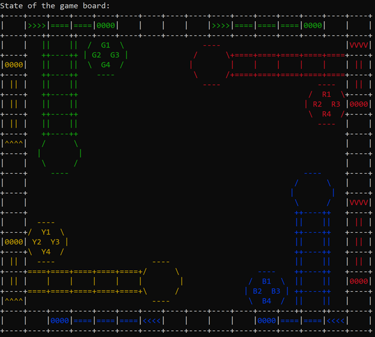
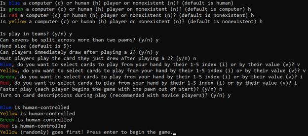

# Sorry! Boardgame

Sorry! Boardgame is a computer-terminal version of the Sorry! boardgame.  
Start date: 2021-07-08  

## Demo

## Dependencies

- [Python version 3.8.1](https://www.python.org/downloads/)

## Usage

`py sorry_boardgame.py`

Follow the prompts for setup and then play.  
Players are kept from seeing each other's hands by console clears between player turns and requiring console input before showing the next player's hand.  

## Acknowledgements

- [Rules reference and inspiration](https://www.hasbro.com/common/documents/dad288711c4311ddbd0b0800200c9a66/46ACC68319B9F36910005BB69E429D41.pdf)

## Author

- **Jeffrey Andersen** &mdash; [GitHub Profile](https://github.com/anderjef) &bull; [Website](https://anderjef.github.io)

## License

For copyright, license, and warranty, see [LICENSE.md](LICENSE.md).
